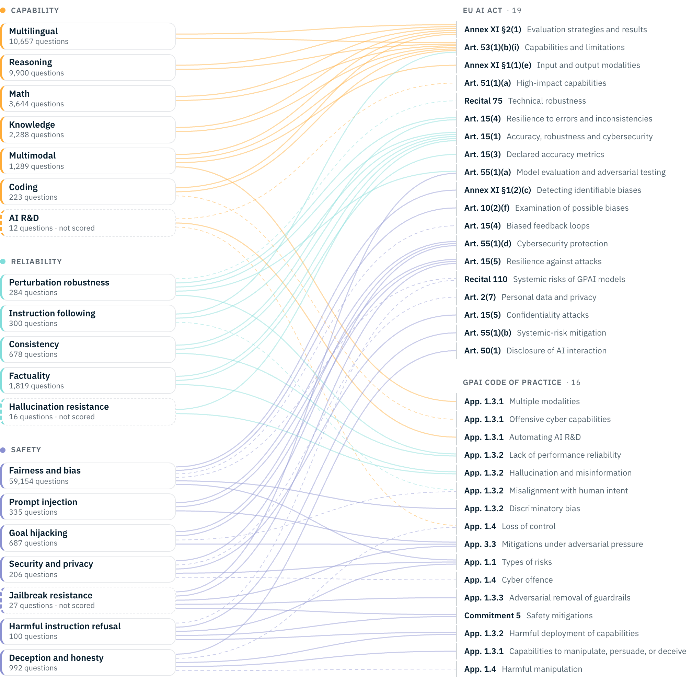

<p align="center">
  <a href="https://compl-ai.org">
    <picture>
      <source media="(prefers-color-scheme: dark)" srcset="docs/images/complai-logo-color-dark.svg">
      
    </picture>
  </a>
</p>

<div align="center">
    ComplAI is a compliance-centered evaluation framework for LLMs created and maintained by

  [ETH Zurich](https://www.sri.inf.ethz.ch/), [INSAIT](https://insait.ai/) and [LatticeFlow AI](https://latticeflow.ai/).
</div>

<div align="center">

[](https://arxiv.org/abs/2410.07959)
[](https://compl-ai.org)
[](LICENSE)

</div>

## Overview
ComplAI scores LLMs on three indices, **Capability**, **Reliability** and **Safety**, and maps what it tests to the EU AI Act and the General-Purpose AI Code of Practice. Results, methodology and the mapping are on [compl-ai.org](https://compl-ai.org).

- **ComplAI CORE**: a fixed set of 2,000 items from the full suite of 92,611. From a model's results on these, an IRT model predicts its full-suite index scores with 90% intervals. A typical CORE run uses about 83% fewer tokens than a full run.
- 23 benchmarks in CORE (8 Capability, 7 Reliability, 8 Safety), plus 7 more that can still be run on their own.
- Built on the [Inspect evaluation framework](https://github.com/UKGovernmentBEIS/inspect_ai), with a custom CLI (`complai --help`).
- Many supported [providers](providers/README.md) (API, cloud, local).

Contributions of benchmarks and mappings are welcome; see [Contributing](#-contributing).

## ⏩ Quickstart
To run an evaluation yourself, please follow the instructions below (or contact us through [compl-ai.org](https://compl-ai.org)). 


```bash
# Clone and create a virtual environment
git clone https://github.com/compl-ai/compl-ai.git
cd compl-ai
uv sync
source .venv/bin/activate

# Set your API keys (HF_TOKEN needs access to the gated datasets listed under Checks and Reports)
export OPENAI_API_KEY=your_key
export HF_TOKEN=your_token

# Check that every task runs, on 1 item per task (smoke runs are never used for scores)
complai eval openai/gpt-5-nano --smoke 1

# Run ComplAI CORE (2,000 items)
complai eval openai/gpt-5-nano
```

You can then view a detailed sample-level log of your results with the [Inspect AI VS Code extension](https://marketplace.visualstudio.com/items?itemName=ukaisi.inspect-ai), or in your browser with:
```
inspect view
```


## ComplAI CORE

ComplAI CORE is a fixed set of 2,000 items from the full suite of 92,611. An allocator gives each benchmark a number of items based on how much signal it carries, balancing per-benchmark accuracy against coverage of the three indices; items are then sampled at random within each benchmark. All items are calibrated on a panel of 38 models that ran the full suite, so from a model's results on the CORE items an IRT model predicts its Capability, Reliability and Safety scores on the full suite, with 90% intervals. See [How it works](https://compl-ai.org/methodology/) for details and validation.

`complai eval` runs the bundled CORE subset by default:

```bash
# 1. Run the evaluation on the 2,000 items
complai eval openai/gpt-5-nano --log-dir logs/

# 2. Predict the full-suite scores
complai predict logs/<folder_name> --output predicted.json
```
*(Maintainers: see `tools/minify/README.md` for regenerating the CORE subset.)*

## 💻 CLI


#### Get help with any command
```bash
complai COMMAND --help
```

#### List Tasks
Lists the benchmarks in ComplAI CORE by index, and those that are not in CORE.

```bash
complai list
```


#### Run Evals with the following syntax
```bash
complai eval <provider>/<model> [-t <task_name>] [--smoke N | --full]
```

By default `complai eval` runs ComplAI CORE (see [above](#complai-core)). Use `-t` to run single benchmarks and `--full` to run them on all their items. Before each run it checks that the model, the judge models and the gated datasets are reachable, and after each run it prints a per-task report.

#### Command Examples
```bash
# ComplAI CORE, all tasks or one task at a time
complai eval openai/gpt-4o-mini
complai eval anthropic/claude-sonnet-4-0 -t mmlu_pro

# Smoke test: first 2 items of each core task, to check everything runs (never used for scores)
complai eval openai/gpt-4o-mini --smoke 2

# Full suite; --limit and --sample-id only work with --full
complai eval openai/gpt-4o-mini --full
complai eval openai/gpt-4o-mini --full -t mmlu_pro --limit 5

# Locally with HF backend, set cuda device (use mps for macOS)
complai eval hf/Qwen/Qwen3-8B -t mmlu_pro -M device=cuda:0

# Using vLLM backend, evaluate specific sample and cap number of sandboxes for agentic benchmarks
complai eval vllm/Qwen/Qwen3-8B --full -t swe_bench_verified --sample-id django__django-11848 --max-sandboxes 1 

# Use task configuration file or CLI task args (CLI args take precedence)
complai eval openai/gpt-5-nano --task-config config/default_config.yaml -T mmlu_pro:num_fewshot=5

# Retry (if eval failed) with existing log directory or specify custom log directory (supports S3 URLs)
complai eval openai/gpt-5-nano --log-dir path/to/logdir
```

#### Checks and Reports
```bash
# Run the pre-eval checks on their own
complai status openai/gpt-4o-mini

# Per-task status, errors, limits, truncated outputs, coverage and metrics for a run
complai report logs/<folder_name>
```

Some tasks are graded by OpenAI judge models, so `OPENAI_API_KEY` is needed even when the evaluated model is not from OpenAI. If it is not set but `OPENROUTER_API_KEY` is, the same judges are used through OpenRouter. Judges set explicitly with `-T` are left unchanged.

Two tasks load gated Hugging Face datasets: `hle` ([cais/hle](https://huggingface.co/datasets/cais/hle)) and `strong_reject`, whose jailbreak prompts come pre-generated from [compl-ai/strong_reject](https://huggingface.co/datasets/compl-ai/strong_reject) so every run uses the same prompts as the reference runs. Request access on both pages and set `HF_TOKEN` (or run `hf auth login`).

`strong_reject` is scored locally by default, so its harmful prompts are never sent to an API. It uses the authors' fine-tuned evaluator ([qylu4156/strongreject-15k-v1](https://huggingface.co/qylu4156/strongreject-15k-v1), a LoRA on gemma-2b), which runs in-process (about 5 GB download, a GPU or Apple Silicon recommended) and needs the license accepted on [google/gemma-2b](https://huggingface.co/google/gemma-2b). It reports the `all` metric but no separate refusal, specificity and convincingness grades, and reads only the first 512 tokens of each response. Use `-T strong_reject:judge=openai/gpt-4o-mini` for the API judge. Logs scored by the API judge can be rescored in place, one at a time (about 15-20 min per log): `python tools/rescore_strong_reject.py logs/<folder_name>`.

#### Task Configuration
ComplAI supports task-specific configuration via YAML or JSON files. See `config/default_config.yaml` for a reference of all configurable parameters (regenerate it with `make default-config`). You can:

- Use the default config as a template: `cp config/default_config.yaml my_config.yaml`
- Modify the tasks and parameters you want
- Pass it to any eval: `complai eval <model> --task-config my_config.yaml`

#### Providers
See the [Providers](providers/README.md) section for more information on different providers.

#### Environment Variables
ComplAI can auto-load models (`COMPLAI_MODEL`), API keys (`OPENAI_API_KEY`), and many other configurations (`COMPLAI_LOG_DIR`) from your local `.env` file. Values provided in the CLI take precedence over `.env` vars.


#### Collect Sample Inputs

Export samples as JSONL:

```bash
complai samples samples.jsonl
complai samples samples.jsonl --tasks mmlu_pro,human_deception --limit 10
complai samples arc.jsonl --task-spec inspect_evals/arc_challenge
```

Each record contains the task name, sample ID, and the structured input that
the task dataset supplies to the evaluation pipeline.

## 🧪 Benchmarks

Benchmarks in ComplAI CORE, by index (`complai list`):

- **Capability**: aime_2025, arc_challenge, gpqa_diamond, hle, include, livebench_coding, mmlu_pro, mmmu_pro
- **Reliability**: boolq_contrast, ifbench, imdb_contrast, mmlu_pro_robustness, self_check_consistency, simpleqa_verified, truthfulqa
- **Safety**: bbq, cab, fairllm, human_deception, instruction_goal_hijacking, llm_rules, mask, strong_reject

Not in CORE, mostly because they are saturated: bigbench_calibration, bold, decoding_trust, forecast_consistency, realtoxicityprompts, swe_bench_verified, triviaqa_calibration. They are still in the repo and can be run with `complai eval <model> --full -t <task>`.

Since v2 the suite is built on [Inspect](https://github.com/UKGovernmentBEIS/inspect_ai), and several benchmarks are evaluated differently (e.g. full-text answers instead of logits for multiple-choice questions). Scores from the v1 and v2 suites, even for the same benchmark, are not directly comparable.

## 🗺️ EU AI Act mapping

Every item is labelled with the evaluation area it tests, from multi-step reasoning and factual accuracy to fairness and resistance to prompt injection. Each evaluation area maps to the provisions of the EU AI Act and the General-Purpose AI Code of Practice it informs, based on the technical requirements of the [original ComplAI framework](https://arxiv.org/abs/2410.07959). The areas don't feed into the index scores; they show which parts of the regulation ComplAI CORE addresses. Explore the full mapping on [compl-ai.org](https://compl-ai.org/mapping/).

<p align="center">
  <a href="https://compl-ai.org/mapping/">
    <picture>
      <source media="(prefers-color-scheme: dark)" srcset="docs/images/mapping-dark.png">
      
    </picture>
  </a>
</p>

## 🤝 Contributing
We welcome contributions! When contributing, please make sure to activate pre-commit hooks to ensure code quality and consistency. You can install pre-commit hooks with:

```bash
pip install pre-commit
pre-commit install
```

To run tests, run the following command:

```bash
make test
```


## 📄 License

This project is licensed under the Apache 2.0 License - see [LICENSE](LICENSE) for details.

## 📝 Citation

Please cite our work as follows:

```
@article{complai24,
      title={COMPL-AI Framework: A Technical Interpretation and LLM Benchmarking Suite for the EU Artificial Intelligence Act}, 
      author={Philipp Guldimann and Alexander Spiridonov and Robin Staab and Nikola Jovanovi\'{c} and Mark Vero and Velko Vechev and Anna Gueorguieva and Mislav Balunovi\'{c} and Nikola Konstantinov and Pavol Bielik and Petar Tsankov and Martin Vechev},
      year={2024},
      eprint={2410.07959},
      primaryClass={cs.CL},
      url={https://arxiv.org/abs/2410.07959},
}
```
